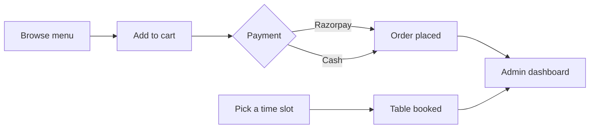

<div align="center">


<br>


<br><br>


</div>

---

## ☕ About

**Aromea** is a full-stack cafe website. Customers browse the menu, filter by diet, order with online or cash payment and book a table. Admins manage everything from a dashboard.

## ✨ Features

| 🍽️ Menu | 🛒 Ordering | 📅 Reservations |
|---|---|---|
| Categories: beverages, dishes, desserts | Cart and checkout | Pick a date and time slot |
| 🟢 Veg / 🔴 Non-Veg labels | 💳 Razorpay online payment | Instant booking confirmation |
| 💪 High-protein dishes with protein content | 💵 Cash on delivery | Admin can view all bookings |
| Search and filter the full catalogue | Order history | |

| 🔐 Accounts | ⭐ Feedback | 🛠️ Admin dashboard |
|---|---|---|
| Register and login with JWT | Star-rating form | Manage orders and reservations |
| Secure password handling | Contact form | Role-based access, admins only |

## 🔄 How it works



## 🧰 Tech stack

| Layer | Technology |
|---|---|
| Frontend | HTML, CSS, JavaScript |
| Backend | Node.js, Express |
| Database | SQLite |
| Auth | JWT (JSON Web Tokens) |
| Payments | Razorpay |

## 📸 Screenshots

<div align="center">


<br><br>

| Menu with Veg / Non-Veg tags | High-protein section |
|:---:|:---:|
|  |  |

| Table reservation | Feedback form |
|:---:|:---:|
|  |  |

</div>

## 🚀 Quick start

**1. Backend**

```bash
cd backend
npm install
node fixdb.js     # sets up the database with the menu items
node server.js    # starts the API on http://localhost:5000
```

**2. Environment variables.** Create `backend/.env` (it is git-ignored and never uploaded):

```env
JWT_SECRET=your_secret_here
RAZORPAY_KEY_ID=your_key_id
RAZORPAY_KEY_SECRET=your_key_secret
```

**3. Frontend.** Open `frontend_design/index.html` with the VS Code **Live Server** extension (port 5500).

**4. Make an admin.** Register on the site, then run:

```bash
node makeAdmin.js youremail@example.com
```

<details>
<summary><b>💳 Razorpay test details</b></summary>

<br>

Use these only in test mode.

| Method | Details |
|---|---|
| UPI | `success@razorpay` |
| Card | `5104 0155 5555 5558` · any future expiry · CVV `123` · OTP `1234` |

</details>

<details>
<summary><b>📁 Project structure</b></summary>

<br>

```
Aromea_ca/
├── backend/
│   ├── routes/        # auth, menu, orders, reservations, feedback, contact, payment
│   ├── middleware/    # JWT verify, admin role check
│   ├── server.js      # Express app entry point
│   ├── db.js          # SQLite connection
│   ├── schema.sql     # Database schema
│   ├── setup.js       # Full DB reset + seed
│   ├── fixdb.js       # Quick DB fix without full reset
│   └── makeAdmin.js   # Promote a user to admin
└── frontend_design/
    ├── index.html         # Home: specials, best sellers
    ├── menu.html          # Full menu by category
    ├── catalogue.html     # Search and filter
    ├── cart.html          # Cart, COD and Razorpay checkout
    ├── login.html         # Register / login
    ├── reservation.html   # Table booking
    ├── feedback.html      # Star rating form
    ├── contact.html       # Contact form
    ├── admin.html         # Admin dashboard
    ├── js/                # main.js, menuData.js, data.js, admin.js
    └── images/            # Food photos
```

</details>

## 📚 What I learned

- Building a REST API with Express and SQLite
- JWT authentication and role-based access control
- Integrating a real payment gateway (Razorpay)
- Connecting a vanilla JavaScript frontend to a backend API

## 🔮 Roadmap

- [ ] Deploy the app online
- [ ] Email or SMS confirmation for orders and bookings
- [ ] Live order tracking for customers

---

<div align="center">

Made with ☕ by [ashu-gaur-io](https://github.com/ashu-gaur-io)

</div>
